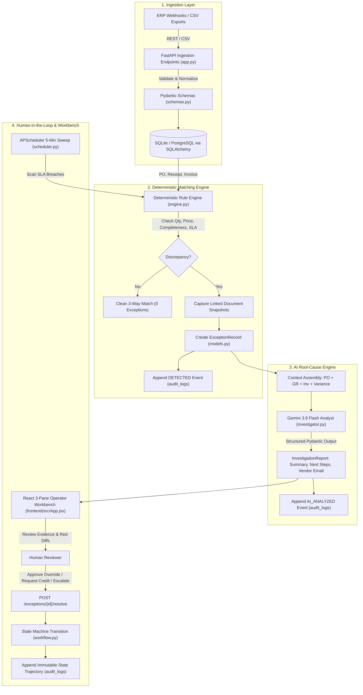

# OpsTrace ERP: 3-Way Matching & Forensic Investigation Platform

[](https://www.python.org/)
[](https://fastapi.tiangolo.com/)
[](https://react.dev/)
[](https://www.sqlalchemy.org/)
[](https://ai.google.dev/)
[](https://docs.pytest.org/)

OpsTrace is an enterprise-grade automated 3-way matching and forensic investigation engine for procurement workflows. It bridges the gap between chaotic ERP transactional data (Purchase Orders, Warehouse Goods Receipts, and Accounts Payable Invoices) and financial accountability.

---

## Table of Contents

- [Core Architectural Philosophy](#core-architectural-philosophy)
- [System Architecture](#system-architecture)
- [Project Directory Structure](#project-directory-structure)
- [Feature Modules & Implementation Deep Dive](#feature-modules--implementation-deep-dive)
  - [Step 1: Relational Schema & Synthetic ERP Data](#step-1-relational-schema--synthetic-erp-data)
  - [Step 2: Transaction Ingestion Layer (REST + Bulk CSV)](#step-2-transaction-ingestion-layer-rest--bulk-csv)
  - [Step 3: Deterministic 3-Way Reconciliation Engine](#step-3-deterministic-3-way-reconciliation-engine)
  - [Step 4: AI Operations Analyst & Root-Cause Engine](#step-4-ai-operations-analyst--root-cause-engine)
  - [Step 5: Human-in-the-Loop Workflow & Immutable Audit Trail](#step-5-human-in-the-loop-workflow--immutable-audit-trail)
  - [Step 6: Operator Workbench & Automated Test Suite](#step-6-operator-workbench--automated-test-suite)
- [REST API Reference](#rest-api-reference)
- [CLI Reference](#cli-reference)
- [Getting Started & Local Setup](#getting-started--local-setup)
- [Automated Testing Suite](#automated-testing-suite)

---

## Core Architectural Philosophy

1. **Zero LLM for Arithmetic**: Discrepancy detection, financial math, and variance quantification are 100% deterministic pure Python rules.
2. **AI for Forensic Operations**: Google Gemini 3.8 Flash acts strictly as an operations analyst—synthesizing raw document snapshots into plain-English root causes, recommending actionable next steps, and drafting vendor correspondence.
3. **Accountability & Immutable Audit Trail**: Financial transactions and approval overrides require human sign-off. Every state transition is recorded in an append-only audit log with before/after state trajectories and actor identification (`SYSTEM`, `AI_AGENT`, or human reviewer).

---

## System Architecture



---

## Project Directory Structure

```
opstraceerptool/
├── app.py                   # FastAPI REST API, routing, lifespan, and static UI mounting
├── cli.py                   # Command-line interface for serving, seeding, reconciling, and testing
├── csv_parser.py            # Case-insensitive CSV parsing with aliases and BOM support
├── database.py              # SQLAlchemy engine, SessionLocal, and DB initialization
├── engine.py                # Pure Python deterministic 3-way matching rules & snapshot builder
├── investigator.py          # Gemini 3.8 Flash AI Operations Analyst with structured outputs
├── models.py                # SQLAlchemy ORM models (PO, Receipt, Invoice, Exception, AuditLog)
├── scheduler.py             # Background APScheduler running 5-minute reconciliation sweeps
├── schemas.py               # Pydantic schemas for payload validation, normalization, and reports
├── seed_data.py             # Synthetic ERP generator with 75 realistic flows and injected failure modes
├── verify_seed.py           # Verification script for database seeding integrity
├── requirements.txt         # Pinned Python package dependencies
├── frontend/                # React 19 + Vite 3-Pane Operator Workbench
│   ├── index.html           # HTML entry point with OpsTrace workbench title
│   ├── package.json         # Frontend dependencies (Lucide icons, Tailwind/CSS)
│   ├── vite.config.js       # Vite configuration with /ui/ base path and backend proxy
│   └── src/
│       ├── App.jsx          # 3-Pane Workbench (Queue, Side-by-side Evidence, Copilot)
│       ├── index.css        # Visual styling, badge themes, and red discrepancy highlights
│       └── main.jsx         # React DOM mount point
└── tests/                   # Pytest automated test suite (52 tests)
    ├── test_erp_mvp.py                              # Step 1: Model relations & failure mode seeding
    ├── test_ingestion_api.py                        # Step 2: REST webhooks & CSV upload validation
    ├── test_reconciliation_engine.py                # Step 3: Deterministic matching & snapshot creation
    ├── test_ai_investigator.py                      # Step 4: AI root cause structured outputs
    ├── test_workflow_audit.py                       # Step 5: State machine & append-only audit logs
    └── test_step6_comprehensive_edge_cases.py       # Step 6: Full lifecycle & edge-case integration
```

---

## Feature Modules & Implementation Deep Dive

### Step 1: Relational Schema & Synthetic ERP Data
- **Implementation**: [`models.py`](models.py), [`database.py`](database.py), [`seed_data.py`](seed_data.py)
- **Schema**:
  - `purchase_orders`: Authoritative procurement contracts (`po_number`, `vendor_id`, `sku`, `quantity`, `unit_price`, `total_amount`).
  - `goods_receipts`: Physical warehouse dock logs (`gr_number`, `po_number`, `quantity_received`, `received_date`).
  - `invoices`: Accounts Payable billing records (`invoice_number`, `po_number`, `quantity_billed`, `unit_price`, `payment_status`).
  - `exceptions`: Discrepancy audit records with raw JSON snapshots and calculated variance amounts.
  - `audit_logs`: Append-only chronological event log tracking `before_state`, `after_state`, and actor.
- **Injected Failure Modes**:
  1. **3-Way Match Discrepancy**: PO ordered = 100, Warehouse received = 80, Invoice billed = 100.
  2. **Price Variance**: Contracted PO price = \$10.00, Invoice billed = \$12.00 (+20% unauthorized markup).
  3. **Duplicate Invoice**: Resubmission of same invoice or identical amount and vendor within 48 hours.
  4. **Ghost Receipt / Missing PO**: Invoice arrives with no warehouse receipt after 7 days, or references an invalid PO.

### Step 2: Transaction Ingestion Layer (REST + Bulk CSV)
- **Implementation**: [`schemas.py`](schemas.py), [`csv_parser.py`](csv_parser.py), [`app.py`](app.py)
- **Validation & Sanitization**:
  - Whitespace trimming on identifiers (`po_number`, `vendor_id`, `sku`).
  - ISO uppercase currency code standardization (`" usd "` $\rightarrow$ `"USD"`).
  - Automated monetary total computation (`total_amount = round(qty * unit_price, 2)`).
  - Robust CSV header aliasing handling common variations (`PO Number`, `Supplier ID`, `Item SKU`, `Qty`, `Price`).

### Step 3: Deterministic 3-Way Reconciliation Engine
- **Implementation**: [`engine.py`](engine.py)
- **Pure Deterministic Logic**: Zero LLM hallucination for mathematical checks.
  - `QUANTITY_MISMATCH`: `invoice.qty != receipt.qty or receipt.qty != po.qty`
  - `PRICE_VARIANCE`: `invoice.unit_price > po.unit_price`
  - `MISSING_PO` / `MISSING_RECEIPT`: Invoice exists without upstream contract or receiving record.
  - `SLA_BREACH`: Documents pending approval exceeding SLA thresholds (e.g. > 3 days).
  - `DUPLICATE_INVOICE`: Invoices matching identical vendor and amount within 48-hour window.
- **Raw Document Snapshots**: Automatically packages full JSON representations of the PO, Goods Receipt, and Invoice directly inside the `ExceptionRecord` for forensic auditability.

### Step 4: AI Operations Analyst & Root-Cause Engine
- **Implementation**: [`investigator.py`](investigator.py)
- **Gemini 3.8 Flash Integration**: Context-assembled prompts evaluated via `google-genai` SDK with strict Pydantic structured output:
  - `root_cause_summary`: High-level plain-English explanation quantifying dollar variance and operational exposure.
  - `recommended_actions`: 2–3 concrete next steps (e.g., request credit memo, dock inventory recount).
  - `draft_communication`: Ready-to-send email template addressed to the vendor or internal buyer.
- **Resilient Fallback**: Includes a deterministic fallback analyst when API keys or network are offline.

### Step 5: Human-in-the-Loop Workflow & Immutable Audit Trail
- **Implementation**: [`workflow.py`](workflow.py), [`scheduler.py`](scheduler.py)
- **State Machine**:
  ```
  [DETECTED] ──> [AI_ANALYZED] ──> [APPROVED_FOR_PAYMENT]  (OVERRIDE_AND_PAY)
                               └──> [CREDIT_MEMO_REQUESTED] (REQUEST_CREDIT_MEMO)
                               └──> [ESCALATED]            (ESCALATE)
                               └──> [DISMISSED]            (DISMISS)
  ```
- **Audit Logging**: Every transition logs an append-only record with timestamp, actor (`SYSTEM`, `AI_AGENT`, human reviewer `user_id`), before/after state, and notes.
- **Automated Sweep**: Background `APScheduler` daemon sweeps the database every 5 minutes to detect aging orders and SLA breaches.

### Step 6: Operator Workbench & Automated Test Suite
- **Implementation**: [`frontend/src/App.jsx`](frontend/src/App.jsx), [`tests/test_step6_comprehensive_edge_cases.py`](tests/test_step6_comprehensive_edge_cases.py)
- **3-Pane React Workbench**:
  1. **Exception Queue (Left)**: Filterable list sorted by monetary exposure (`variance_amount` descending) and severity.
  2. **Evidence & Timeline (Center)**: Side-by-side comparison of PO vs. Goods Receipt vs. Invoice with mismatched fields highlighted in red, plus chronological audit trail.
  3. **AI Copilot & Action Bar (Right)**: Displays plain-English root cause, pre-drafted vendor email with one-click copy, and one-click human resolution actions (`Approve Override`, `Request Credit Memo`, `Hold Payment & Escalate`).

---

## REST API Reference

| Method | Endpoint | Description | Request Payload |
|---|---|---|---|
| `GET` | `/health` | API and SQLite connectivity check | None |
| `POST` | `/ingest/po` | Real-time webhook for Purchase Orders | JSON ([`PurchaseOrderIngestSchema`](schemas.py)) |
| `POST` | `/ingest/receipt` | Real-time webhook for Goods Receipts | JSON ([`GoodsReceiptIngestSchema`](schemas.py)) |
| `POST` | `/ingest/invoice` | Real-time webhook for Vendor Invoices | JSON ([`InvoiceIngestSchema`](schemas.py)) |
| `POST` | `/ingest/csv/{entity_type}` | Bulk CSV upload (`po`, `receipt`, `invoice`) | Multipart Form File (`.csv`) |
| `POST` | `/reconcile/batch` | Execute deterministic 3-way matching scan | None |
| `GET` | `/exceptions` | List open exceptions with filtering & sorting | Query params (`severity`, `status`, `limit`) |
| `POST` | `/investigate/{code}` | Run AI Operations Analyst on an exception | None |
| `GET` | `/investigate/{code}` | Retrieve cached investigation report | None |
| `POST` | `/investigate/batch` | Run batch AI investigations on open exceptions | Query params (`limit`, `severity`) |
| `POST` | `/exceptions/{id}/resolve`| Human resolution with audit log append | JSON ([`ResolveExceptionRequest`](schemas.py)) |
| `GET` | `/exceptions/{id}/audit` | Retrieve immutable audit trail for an entity | None |
| `GET` | `/scheduler/status` | Operational status of background sweeper | None |
| `POST` | `/scheduler/sweep` | Trigger immediate background reconciliation | None |

Interactive OpenAPI documentation is available at [http://127.0.0.1:8000/docs](http://127.0.0.1:8000/docs).

---

## CLI Reference

The platform includes a CLI utility ([`cli.py`](cli.py)) to manage all operations:

```bash
# Start backend server with embedded React Workbench
python cli.py serve --port 8000

# Seed database with realistic procurement flows and anomalies
python seed_data.py --count 75

# Run deterministic reconciliation scan across all records
python cli.py reconcile

# Run AI investigation on a specific exception code
python cli.py investigate EXC-2026-0001

# Trigger an immediate background reconciliation sweep
python cli.py sweep

# Execute full pytest automated test suite
python cli.py test
```

---

## Getting Started & Local Setup

### 1. Prerequisites
- Python 3.12+
- Node.js 18+ and npm
- (Optional) `GEMINI_API_KEY` for live Google Gemini 3.8 Flash model execution

### 2. Install Python Dependencies
```bash
pip install -r requirements.txt
```

### 3. Initialize & Seed Database
```bash
python seed_data.py
```

### 4. Build or Develop Frontend
```bash
cd frontend
npm install
npm run build
cd ..
```

### 5. Launch the Platform
```bash
python cli.py serve --port 8000
```
- **Operator Workbench UI**: Open [http://127.0.0.1:8000/ui/](http://127.0.0.1:8000/ui/) in your browser.
- **FastAPI Swagger Docs**: Open [http://127.0.0.1:8000/docs](http://127.0.0.1:8000/docs).

---

## Automated Testing Suite

OpsTrace includes 52 automated tests covering unit functions, schema validations, reconciliation edge cases, and human-in-the-loop lifecycles:

```bash
python -m pytest -v
```

```
============================= test session starts =============================
platform win32 -- Python 3.12.10, pytest-9.2.0, pluggy-1.7.0
rootdir: C:\Users\KRISHNAKANT YADAV\react-concrete\opstraceerptool

tests/test_ai_investigator.py .........                                  [ 17%]
tests/test_erp_mvp.py .........                                          [ 34%]
tests/test_ingestion_api.py ............                                 [ 57%]
tests/test_reconciliation_engine.py ...........                          [ 78%]
tests/test_step6_comprehensive_edge_cases.py ....                        [ 86%]
tests/test_workflow_audit.py .......                                     [100%]

============================= 52 passed in 3.86s ==============================
```
