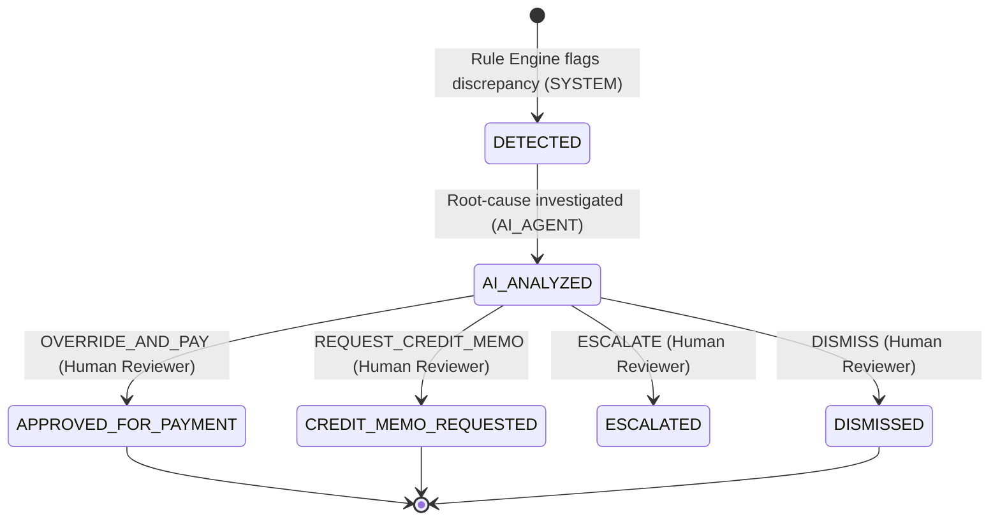

# Opstrace ERP Tool - Step 1: Data Modeling & Synthetic ERP Dataset

## Overview
This module implements the relational data model and synthetic dataset generator for ERP procurement workflows, simulating realistic "messy" enterprise procurement data with injected matching discrepancies and anomalies.

## Relational Schema

The core relational schema consists of 5 tables implemented in `models.py` via SQLAlchemy:

| Table | Primary Key | Key Linking Fields | Purpose |
|---|---|---|---|
| `purchase_orders` | `id` | `po_number` (unique), `vendor_id`, `sku` | Authoritative procurement contracts with approved quantities and unit prices |
| `goods_receipts` | `id` | `gr_number` (unique), `po_number`, `vendor_id`, `sku` | Physical warehouse receiving logs with received quantities and intake timestamps |
| `invoices` | `id` | `invoice_number`, `po_number` (nullable), `vendor_id`, `sku` | Accounts Payable invoices submitted by vendors with billed quantities and unit prices |
| `exceptions` | `id` | `exception_code`, `po_number`, `invoice_number`, `gr_number`, `vendor_id` | Audit records for flagged discrepancies, severity ratings, and investigation diagnostics |
| `audit_logs` | `id` | `entity_type`, `entity_id` | Immutable chronological tracking of all procurement entity lifecycle events |

### Cross-Table Linkage
The three core business tables (`purchase_orders`, `goods_receipts`, and `invoices`) are linked primarily through `po_number` (with secondary matching keys `vendor_id` and `sku`), supported by composite indexes:
- `ix_po_vendor_sku`
- `ix_gr_vendor_sku`
- `ix_invoice_vendor_sku`
- `ix_invoice_vendor_amount_date`

---

## Injected Failure Modes

The synthetic generator (`seed_data.py`) creates 50–100 procurement flows containing both clean workflows and specific injected anomalies:

1. **3-Way Match Discrepancy (Quantity Shortage / Overbilling)**
   - **Pattern**: PO ordered = 100 units, Goods Receipt logged = 80 units, Invoice billed = 100 units.
   - **Exception**: `QTY_MISMATCH_3WAY` (Severity: `HIGH`).

2. **Price Variance (Unauthorized Price Markup)**
   - **Pattern**: Contracted PO unit price = $10.00, Invoice billed unit price = $12.00 (+20% variance).
   - **Exception**: `PRICE_VARIANCE` (Severity: `MEDIUM` to `HIGH`).

3. **Duplicate Invoice**
   - **Pattern A (Exact Number)**: Same `invoice_number` resubmitted within 48 hours.
   - **Pattern B (Identical Amount & Vendor)**: Two distinct invoices from the same vendor for the exact same amount submitted within 48 hours.
   - **Exception**: `DUPLICATE_INVOICE` (Severity: `CRITICAL`).

4. **Ghost Receipt / Missing PO**
   - **Pattern A (Ghost Receipt)**: Invoice arrives > 7 days after PO creation, but warehouse has zero record of goods received.
   - **Pattern B (Missing PO)**: Invoice references an invalid/non-existent PO number or has an orphan reference.
   - **Exception**: `GHOST_RECEIPT_MISSING_GR` and `MISSING_PO` (Severity: `HIGH` / `CRITICAL`).

---

## Step 2: Transaction Ingestion Layer (REST API + Bulk CSV)

The ingestion layer simulates real-time ERP event webhooks and end-of-day batch file exports via FastAPI and Pydantic.

### Endpoints

| Method | Endpoint | Description | Payload Format |
|---|---|---|---|
| `GET` | `/health` | API & database connectivity check | N/A |
| `POST` | `/ingest/po` | Real-time webhook for Purchase Orders | JSON (`PurchaseOrderIngestSchema`) |
| `POST` | `/ingest/receipt` | Real-time webhook for Goods Receipts | JSON (`GoodsReceiptIngestSchema`) |
| `POST` | `/ingest/invoice` | Real-time webhook for Vendor Invoices | JSON (`InvoiceIngestSchema`) |
| `POST` | `/ingest/csv/{entity_type}` | Bulk CSV batch export ingestion (`po`, `receipt`, `invoice`) | Multipart Form File (`.csv`) |

### Data Normalization & Validation (Pydantic)
- **Whitespace Sanitization**: Strips leading/trailing spaces from `po_number`, `vendor_id`, `sku`, `gr_number`, and `invoice_number`.
- **Currency Standardization**: Normalizes currency codes to uppercase 3-letter ISO standards (e.g., `" usd "` -> `"USD"`).
- **Auto-Calculated Totals**: Automatically calculates `total_amount = round(quantity * unit_price, 2)` if omitted in payload.
- **Flexible Date Parsing**: Accepts ISO timestamps (`2026-03-01T10:00:00Z`), standard timestamps (`2026-03-01 10:00:00`), and date strings (`2026-03-01`).
- **Strict Business Constraints**: Enforces positive quantities (`quantity > 0`) and non-negative pricing (`unit_price >= 0`).
- **Flexible CSV Header Mapping**: Case-insensitive aliases (e.g. `PO Number`, `Supplier ID`, `Item SKU`, `Qty`, `Price`).
- **Audit Trail**: Every webhook or bulk CSV ingestion logs an entry in `audit_logs`.

---

## Step 3: Deterministic Reconciliation & Exception Engine

OpsTrace uses pure Python deterministic rules to evaluate linked procurement records—**never an LLM** for arithmetic or discrepancy detection.

### 3-Way Match Rules

1. **Quantity Check** (`QUANTITY_MISMATCH`)
   - **Evaluation**: `invoice.quantity_billed != receipt.quantity_received or receipt.quantity_received != po.quantity`
   - **Severity**: `High` if overbilling detected or variance > 10%, else `Medium`
   - **Variance Amount**: `abs(invoice.qty - receipt.qty) * invoice.unit_price`

2. **Price Check** (`PRICE_VARIANCE`)
   - **Evaluation**: `invoice.unit_price > po.unit_price`
   - **Severity**: `High` if markup $\ge$ 10% or total variance $\ge$ $250, else `Medium`
   - **Variance Amount**: `(invoice.unit_price - po.unit_price) * invoice.quantity_billed`

3. **Completeness Check** (`MISSING_PO`, `MISSING_RECEIPT`)
   - **Evaluation**: Invoice exists, but PO is `None` or Goods Receipt is `None`
   - **Severity**: `High`
   - **Variance Amount**: `invoice.total_amount`

4. **SLA Breach Check** (`SLA_BREACH`)
   - **Evaluation**: `status in ["PENDING_APPROVAL", "PENDING_MATCH"]` and `created_at < now() - timedelta(days=3)`
   - **Severity**: `Medium`

5. **Duplicate Invoice Check** (`DUPLICATE_INVOICE`)
   - **Evaluation**: Same `invoice_number` or identical vendor & total amount within 48 hours
   - **Severity**: `High`

### Exception Record Schema & Snapshots
When an anomaly is flagged, OpsTrace creates an `ExceptionRecord` with:
- `exception_code`: Unique identifier (e.g., `EXC-A1B2C3D4`)
- `exception_type`: Standardized discrepancy code
- `severity`: `High`, `Medium`, or `Low`
- `variance_amount`: Exact monetary discrepancy in USD
- `raw_snapshots`: Comprehensive JSON snapshot of the linked `purchase_order`, `goods_receipt`, and `invoice` at the time of evaluation.
- `discrepancy_details`: Diagnostic breakdown with exact numerical deltas.

---

## Step 4: AI Investigation & Root-Cause Engine

Once the deterministic rule engine flags an exception and captures linked snapshots, OpsTrace passes the structured context to an **AI Operations Analyst** (powered by Gemini 3.8 Flash via `google-genai`).

### Context Assembly
The engine bundles the PO, Goods Receipt, Invoice, and rule violation diagnostics into a clean JSON prompt:
```json
{
  "exception_code": "EXC-2026-0001",
  "exception_type": "QTY_MISMATCH_3WAY",
  "variance_amount": 2300.0,
  "linked_documents": {
    "purchase_order": { ... },
    "goods_receipt": { ... },
    "invoice": { ... }
  }
}
```

### Structured Output Schema (`InvestigationReport`)
The LLM is forced via Pydantic structured output to return:
- `root_cause_summary`: Plain-English explanation of what broke and the financial exposure.
- `recommended_actions`: 2–3 concrete operational next steps (e.g. request credit memo, hold invoice, warehouse dock check).
- `draft_communication`: A ready-to-send email snippet addressed to the vendor or internal approver.

### API & CLI Usage
- **Investigate Exception via API**:
  `POST /investigate/{exception_code}`
- **Retrieve Cached Report**:
  `GET /investigate/{exception_code}`
- **Batch Investigation**:
  `POST /investigate/batch?limit=5`
- **CLI Command**:
  ```bash
  python cli.py investigate EXC-2026-0001
  ```

---

## Step 5: Human-in-the-Loop Workflow & Immutable Audit Trail

OpsTrace provides accountability around all financial decisions through an explicit state machine and an immutable, append-only audit trail.

### State Machine Lifecycle


### Action Endpoint (`POST /exceptions/{id}/resolve`)
Allows authorized human reviewers to resolve exceptions with full accountability:
- **`OVERRIDE_AND_PAY`**: Transitions state to `APPROVED_FOR_PAYMENT` and automatically approves the linked invoice (`invoice.payment_status = "APPROVED"`).
- **`REQUEST_CREDIT_MEMO`**: Transitions state to `CREDIT_MEMO_REQUESTED` and places invoice on hold (`invoice.payment_status = "ON_HOLD"`).
- **`ESCALATE`**: Transitions state to `ESCALATED` for senior executive / procurement category review.
- **`DISMISS`**: Transitions state to `DISMISSED`.

### Immutable Audit Trail (`audit_logs`)
Every state transition records an append-only row containing:
- `timestamp`: UTC datetime
- `performed_by`: `SYSTEM`, `AI_AGENT`, or human reviewer (`user_id`)
- `before_state` & `after_state`: Explicit state trajectory
- `details`: Reviewer notes, action rationale, and linked document metadata.

### Automated 5-Minute Background Sweep (`APScheduler`)
- Runs in the background every 5 minutes to detect time-based anomalies (such as approval SLA breaches and overdue unreceived orders).
- Integrated into FastAPI lifecycle (`lifespan`) and accessible via CLI `python cli.py sweep` or API `POST /scheduler/sweep`.

---

## Step 6: Investigation Dashboard & Pytest Suite

### React Workbench (3-Pane Layout)
A dedicated operations operator workbench built with React, Vite, and Lucide icons:

1. **Exception Queue (Left Pane)**
   - Filterable list sorted by financial impact (`variance_amount` descending) and severity.
   - Real-time search across PO numbers, invoices, vendors, and exception codes.
   - Quick filters for severity (`High`, `Medium`, `Low`) and lifecycle status (`Detected`, `AI Analyzed`, `Approved`).

2. **Evidence & Timeline (Center Pane)**
   - **Side-by-side Visual Comparison**: Purchase Order vs. Goods Receipt vs. Invoice.
   - **Discrepancy Highlighting**: Mismatched quantities and unit prices are highlighted with red alerts and contrast styling.
   - **Chronological Immutable Audit Log**: Complete event timeline displaying timestamps, actors (`SYSTEM`, `AI_AGENT`, human reviewer), state transitions (`before` $\rightarrow$ `after`), and auditable notes.

3. **AI Copilot & Action Bar (Right Pane)**
   - **AI Operations Analyst**: Plain-English root cause summary quantifying overbilling risk, 2–3 concrete operational next steps, and a ready-to-send vendor email snippet with one-click copy.
   - **One-Click Human Decision Action Bar**:
     - `Approve Override` (`OVERRIDE_AND_PAY`): Authorizes payment and transitions invoice to `APPROVED`.
     - `Request Credit Memo` (`REQUEST_CREDIT_MEMO`): Puts invoice on hold and flags credit request.
     - `Hold Payment & Escalate` (`ESCALATE`): Routes to senior category management.

### Pytest Edge Case Suite (`tests/test_step6_comprehensive_edge_cases.py`)
Automated tests validating the exact edge cases:
- **Exact 3-Way Match**: Confirms 0 exceptions generated when PO, GR, and Invoice perfectly align.
- **Partial Delivery Mismatch**: Confirms `QUANTITY_MISMATCH` is flagged with exact variance and document snapshots.
- **Duplicate Invoice Ingestion**: Confirms `DUPLICATE_INVOICE` flagged on identical vendor and amount within 48h.
- **Human Approval Lifecycle**: Confirms human decision properly updates exception status, invoice status, and appends to the immutable audit log.

---

## Quick Start

### 1. Requirements
Install dependencies:
```bash
pip install -r requirements.txt
```

### 2. Generate Synthetic ERP Dataset
Run the seeder with default 75 procurement flows:
```bash
python seed_data.py
```
Options:
- `--count <int>`: Number of flows to generate (e.g. `--count 100`).
- `--seed <int>`: Random seed for deterministic reproducibility.

### 4. Run Automated Pytest Suite
Run the 52 comprehensive unit and integration tests:
```bash
python cli.py test
```
Or directly:
```bash
python -m pytest -v
```

### 5. Launch Operator Workbench & API Server
Start the backend server (FastAPI + APScheduler + embedded React UI):
```bash
python cli.py serve --port 8000
```
- **Operator React Workbench**: Open `http://127.0.0.1:8000/ui` in your browser.
- **Interactive OpenAPI Docs**: Open `http://127.0.0.1:8000/docs`.

To run Vite in standalone hot-reload dev mode:
```bash
cd frontend
npm run dev
```
